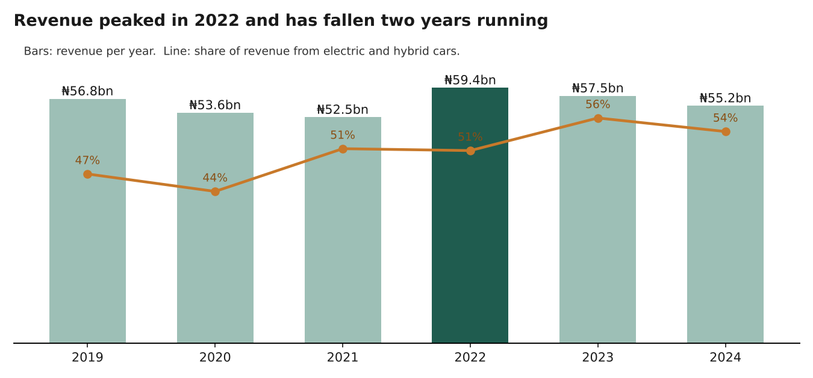

# Automotive Sales Performance, Nigeria (2019 to 2024)

**Charity Umoh, Business Analyst | Business Intelligence**

A Power BI review of ₦335bn in vehicle sales across 10 brands, 5 cities and 5 dealers. The question I set out to answer: **where is revenue coming from, and where is it slipping?**

---

## The short answer

Revenue is flat to falling. It peaked at ₦59.4bn in 2022 and has dropped for two years since, closing 2024 at ₦55.2bn (7% below the peak and 3% below 2019). No single brand, city or dealer carries the business. The clearest growth signal is electric and hybrid cars, which now bring in more than half of revenue.

## Key findings

**1. Two straight years of decline after the 2022 peak.**
2022 was the only growth year (+13%). 2023 fell 3% and 2024 fell another 4%. Units sold followed the same path, so the drop is fewer cars sold, not lower prices.

**2. Electric and hybrid cars are now the majority of revenue.**
Their share went from 47% in 2019 to 56% in 2023 and 54% in 2024. They have been above half every year since 2021. Hybrid is the single largest fuel type at 25.8% of revenue.

**3. No brand dominates, so the brand alone does not win the sale.**
All 10 brands sit between 8.4% and 11.1% of revenue. Kia leads (₦37.2bn), BMW trails (₦28.1bn). In a market this even, dealer coverage and service matter more than the badge.

**4. Volume and value are different stories.**
Hyundai sold the most cars (1,454) at the lowest average price (₦24.7m). Nissan sold the second fewest (1,139) but at the highest average price (₦29.7m), which lifts it to 5th on revenue. Top model by revenue is the Hyundai Santa Fe (₦14.0bn).

**5. Port Harcourt is the strongest city and the most electric.**
Port Harcourt brings in 21.4% of revenue, and 31% of its revenue is electric, the highest of any city. Kano is the smallest city (18.7%) and leans hybrid (31%), with the lowest diesel share (17%).

**6. Each dealer has a weak city.**
SpeedHub leads overall (₦73.1bn) because it sells a pricier mix (average ₦27.4m per car). But dealer results swing widely by city. DriveX earns ₦17.7bn in Ibadan and only ₦9.1bn in Abuja. MegaMotors earns ₦17.5bn in Port Harcourt and only ₦9.2bn in Ibadan.

## What I would recommend

These are proposals for discussion, based on what the data shows.

1. **Find out what drove 2022.** It is the only growth year. If it was a promotion, a model launch or a fleet deal, it may be repeatable.
2. **Put stock and marketing behind electric and hybrid,** starting in Port Harcourt (EV) and Kano (hybrid), where demand is already strongest.
3. **Close the dealer gaps by city.** Use each dealer's best city as its target in its weakest one, for example DriveX in Abuja and MegaMotors in Ibadan.
4. **Protect margin on premium models.** Nissan shows a higher price point can still earn top 5 revenue on lower volume.

## Dashboard

## How I built it

| Step | What I did |
|---|---|
| Data | 1,000 sales transactions, January 2019 to December 2024. Fields include brand, model, body type, fuel, city, dealer, units and price. |
| Checks | Confirmed every row reconciles (units × unit price = total sales). Profiled every column for blanks and spread. |
| Model | Power Query for cleaning and a date table. DAX measures for Revenue, Units, Average Price, Revenue LY, YoY %, and Electric and Hybrid Share %. |
| Visuals | Revenue trend with fuel share, brand ranking, city by fuel matrix, dealer by city matrix. |

**Data note.** This is a practice dataset, not real dealer records. It has known quirks that I flagged rather than hid: 36% of rows show a model year later than the sale date, and the same model appears under several body types (for example the Elantra as a truck). Findings by body type should be read with that in mind.

## Files

| File | What it is |
|---|---|
| `automotive sales perf.pbix` | Power BI report |
| `Automotive_Sales_Data.csv` | Source data |
| `images/revenue_trend.png` | Revenue and fuel share chart used above |

---

**Tools:** Power BI, Power Query, DAX, Excel, Python (data checks)

[Connect with me on LinkedIn](https://www.linkedin.com/in/umoh-charity-7065a5105/)
